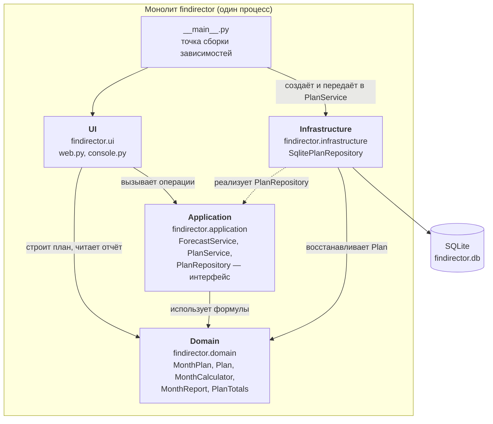

# Диаграмма компонентов (ЛР2-Д1)

Модульный монолит: четыре слоя — подпакеты одного пакета `findirector`, один процесс, одна БД.
Стрелка — направление зависимости (кто кого импортирует). Domain ни от чего не зависит.

