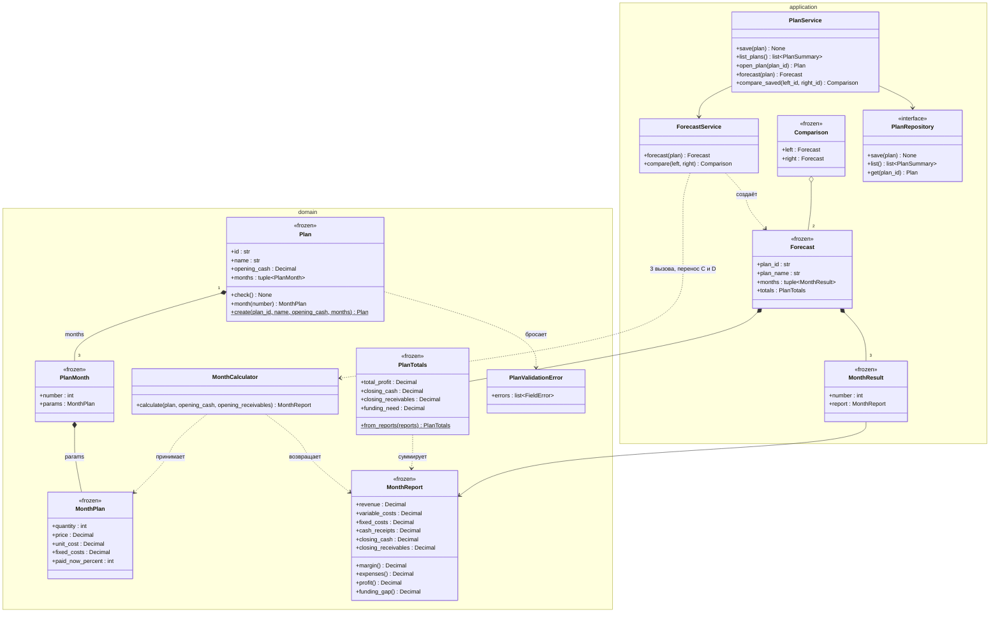

# Диаграмма классов (ЛР2-Д2)

План, три набора параметров месяца, результаты, расчёт и прикладные операции.
`margin`, `expenses`, `profit`, `funding_gap` — производные свойства (вычисляются, не хранятся).

