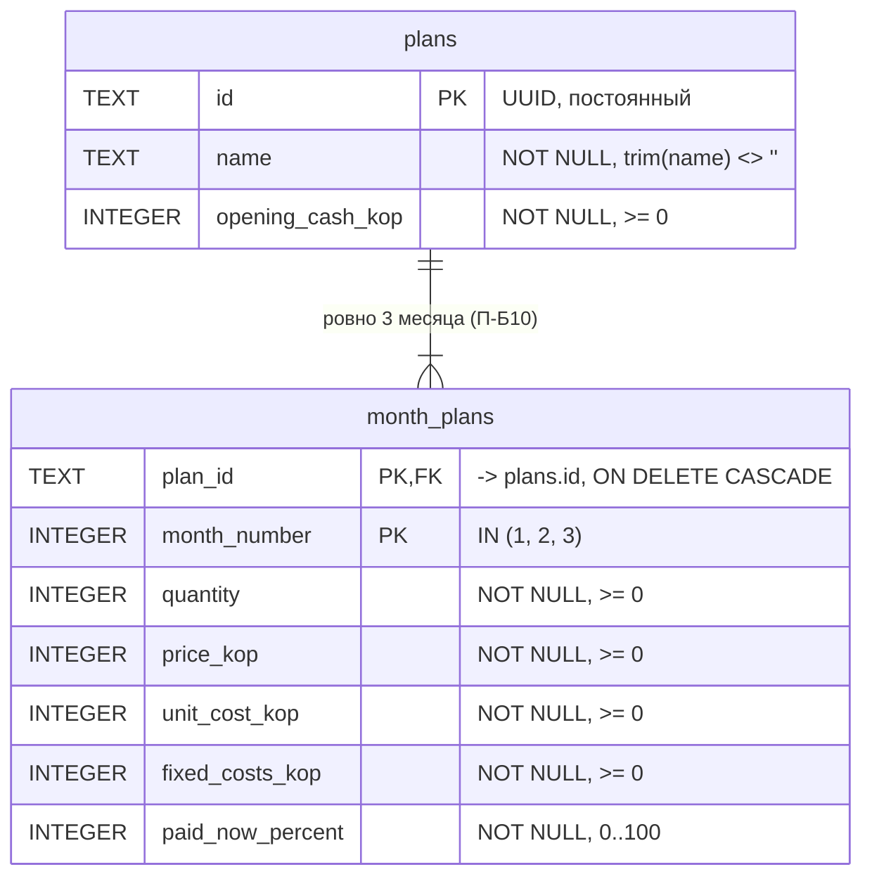

# ER-диаграмма (ЛР2-Д5, уточнена в ЛР4-Д1)

Типы SQLite и ограничения. Денежные поля — целые копейки (`*_kop`).
Составной первичный ключ `(plan_id, month_number)` обеспечивает уникальность номера месяца в плане (П-Б10).

